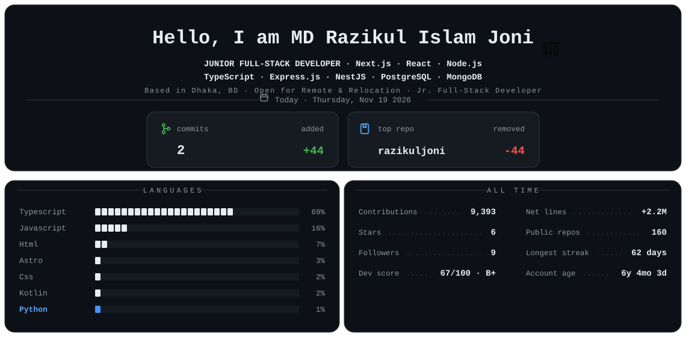
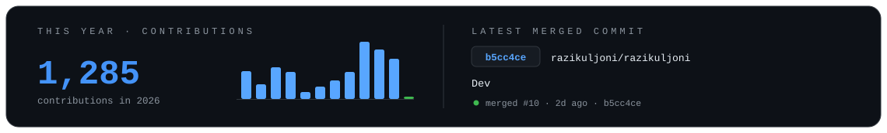

<!-- TODAY:START -->

   
  

<!-- TODAY:END -->

   
  

<!-- Hero Part -->

  <samp>
    <a href="https://razikuljoni.xyz"><b>● Available for Full-Stack, MERN &amp; Frontend Roles · 2026</b></a>
  </samp>

<h1 align="center">
  Hi, I'm <a href="https://razikuljoni.xyz">MD Razikul Islam Joni</a> 👋
</h1>

  

  <b>Full-Stack &amp; MERN Stack Developer</b> with <b>2+ years of production experience</b> delivering real-time monitoring platforms at HawkEyes Digital Monitoring Ltd. 
  Specializing in end-to-end web engineering with <b>Next.js, React 19, TypeScript, Node.js, Express, NestJS, MongoDB, and PostgreSQL</b>, focused on high scalability, sub-second WebSocket telemetry, and modular frontend architectures. 
  Dedicated to building robust, high-performance web systems with clean code principles, and actively seeking high-impact Full-Stack / Frontend engineering opportunities.

<!-- 

  <b>Full-Stack / MERN Engineer &amp; UI Architect</b> with <b>2+ years of production experience</b> (ex-HawkEyes) architecting high-performance real-time dashboards and scalable distributed systems. 
  Proficient across <b>React 19, Next.js 15, TypeScript, Node.js, Express, NestJS, MongoDB, and PostgreSQL</b> — engineering low-latency WebSocket data streaming, contract-first REST APIs, and offline-first business solutions. 
  Committed to clean architecture, type safety, and high-throughput scalability — building resilient full-stack applications engineered to perform under heavy production traffic.

 -->

  
  
  
  
  
  

 

## 👨💻 About Me

Passionate **Full-Stack / MERN / Frontend Developer** based in **Dhaka, Bangladesh**. Specializing in building high-performance web applications, real-time IoT dashboards, and robust REST APIs with clean architecture and modern UX.

- 💼 **Experience**: Former **Junior Frontend Developer** at **HawkEyes Digital Monitoring Ltd.** (Feb 2024 – Apr 2026) — engineered real-time monitoring dashboards with WebSockets, custom chart visualizations, and modular React/Next.js components.
- 🎓 **Education**: Currently pursuing **B.Sc. in Computer Science & Engineering** at **Green University of Bangladesh** (2020 – present).
- 🚀 **Continuous Learning**: Enrolled in the **Reactive Accelerator** program at [Learn with Sumit](https://learnwithsumit.com/), diving deep into React internals, state management, and performance optimization.
- 🎯 **Current Focus**: Actively seeking **Full-Stack**, **MERN Stack**, or **Frontend Developer** opportunities (Full-Time, Remote, Hybrid, or Contract).

---

## ⚡ Tech Stack & Tools

  <table>
    <tr>
      <td align="center" width="96">
         JavaScript
      </td>
      <td align="center" width="96">
         TypeScript
      </td>
      <td align="center" width="96">
         React
      </td>
      <td align="center" width="96">
         Next.js
      </td>
      <td align="center" width="96">
         Redux
      </td>
      <td align="center" width="96">
         Tailwind
      </td>
      <td align="center" width="96">
         HTML5
      </td>
    </tr>
    <tr>
      <td align="center" width="96">
         Node.js
      </td>
      <td align="center" width="96">
         Express
      </td>
      <td align="center" width="96">
         NestJS
      </td>
      <td align="center" width="96">
         PostgreSQL
      </td>
      <td align="center" width="96">
         MongoDB
      </td>
      <td align="center" width="96">
         Prisma
      </td>
      <td align="center" width="96">
         Docker
      </td>
    </tr>
    <tr>
      <td align="center" width="96">
         Git
      </td>
      <td align="center" width="96">
         GitHub
      </td>
      <td align="center" width="96">
         Vercel
      </td>
      <td align="center" width="96">
         Vite
      </td>
      <td align="center" width="96">
         pnpm
      </td>
      <td align="center" width="96">
         Postman
      </td>
      <td align="center" width="96">
         Figma
      </td>
    </tr>
  </table>

---

<!-- FEATURED:START -->
## 🌟 Featured Projects

| Project | Tech Stack | Key Features | Repository |
|:---|:---|:---|:---:|
| **[Circuit-Retail-ERP](https://github.com/razikuljoni/Circuit-Retail-ERP)** | `Next.js` `React` `Prisma` `SQLite` `Tailwind` | Production-ready retail ERP — POS invoicing, stock ledger, expenses & live daily sales analytics. | [View Repo](https://github.com/razikuljoni/Circuit-Retail-ERP) |
| **[SensorGrid](https://github.com/razikuljoni/SensorGrid)** | `Next.js` `WebSockets` `Zustand` `Tailwind` | Real-time IoT monitoring dashboard with live sensor visualization & WebSocket telemetry streaming. | [View Repo](https://github.com/razikuljoni/SensorGrid) |
| **[Z Shop](https://github.com/razikuljoni/z-shop)** | `Next.js` `Express` `MongoDB` `Prisma` | Full-stack e-commerce platform with smart product recommendations & real-time order tracking. | [View Repo](https://github.com/razikuljoni/z-shop) |
| **[InsightDoc](https://github.com/razikuljoni/insightdoc)** | `NestJS` `PostgreSQL` `Prisma` `Docker` | Enterprise RAG platform for PDF analytics with structured extraction & citation answers. | [View Repo](https://github.com/razikuljoni/insightdoc) |
| **[Nexora POS](https://github.com/razikuljoni/nexora-pos)** | `Next.js` `TypeScript` `Zustand` `Tailwind` | Offline-first Point of Sale & predictive inventory management system for high-throughput retail. | [View Repo](https://github.com/razikuljoni/nexora-pos) |
| **[Chronos 3D](https://github.com/razikuljoni/chronos-3d)** | `Three.js` `WebGL` `React` `Framer Motion` | WebGL luxury smartwatch experience with procedural 3D watch rendering & scroll choreography. | [View Repo](https://github.com/razikuljoni/chronos-3d) |
<!-- FEATURED:END -->

---

## 💼 Experience

#### **Jr. Frontend Developer** — *HawkEyes Digital Monitoring Ltd.*
> **Feb 2024 – Apr 2026** · Uttara, Dhaka, Bangladesh · Full-time · On-site
- Architected and delivered responsive, high-performance web applications using **React.js**, **Next.js**, and **TypeScript**, translating complex Figma designs into accessible, pixel-perfect UI/UX interfaces.
- Integrated complex **REST APIs** and **WebSockets**, utilizing **Redux Toolkit**, **RTK Query**, and **Zustand** for state management and seamless data synchronization.
- Collaborated closely with backend engineers, UX designers, and project stakeholders to establish API contracts, improve page load times, and ship features on schedule.
- Engineered reusable component systems and spearheaded frontend performance optimizations, boosting Core Web Vitals and user engagement across core web properties.

---

## 📊 GitHub Analytics

  
  

 

  

 

  

  

---

## 📬 Connect With Me

  <h3>READY TO COLLABORATE &amp; SHIP</h3>
  
Feel free to reach out for full-stack engineer opportunities, frontend architecture consultations, or exciting open-source collaborations.

  
  
  
  
  
  

 

  <!-- 

    <em>⚡ off the clock: 🍜 street-food explorer · 🎧 synthwave &amp; lo-fi coding flow · 🎮 competitive gaming · 📚 system design hunter</em>
  
 -->

  
<i>💡 Open for Full-Stack, MERN Stack, and Frontend Developer positions. Let's build something awesome together!</i>

